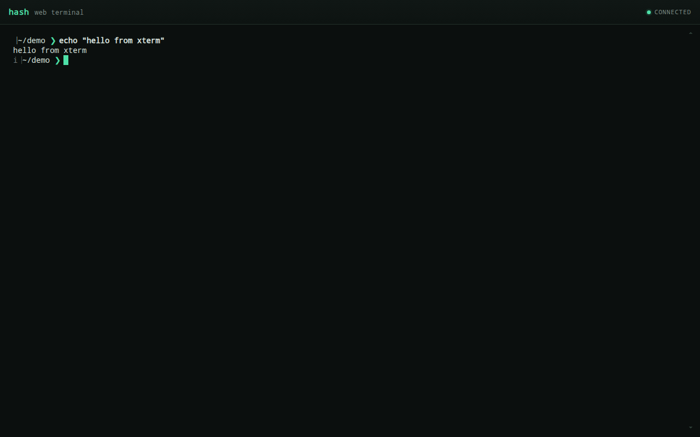
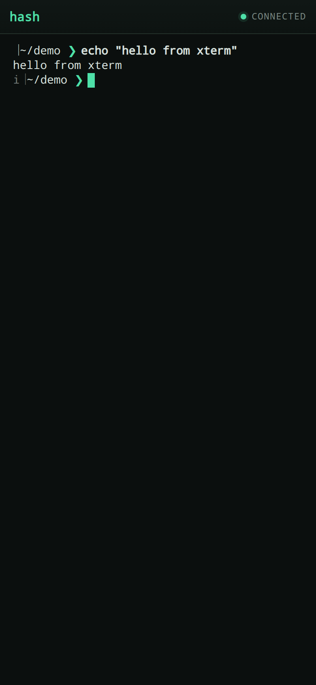

# Web Terminal

Hash can serve its own terminal in a browser. The page uses
[xterm.js](https://xtermjs.org/) for rendering, and every browser tab is backed
by a real pseudo-terminal running a Hash session, so editing, completion,
prompts, `??` agent requests, and interactive programs behave as they do in a
local terminal.

## Quick start

```bash
hash web
# Hash web terminal: http://127.0.0.1:7681/?token=<random token>
# Listening on 127.0.0.1:7681 — press Ctrl+C to stop
```

Open the printed URL. The token in it is generated for each server run and is
required both for the page and for the terminal connection.

| Flag | Default | Description |
| --- | --- | --- |
| `--listen` | `127.0.0.1:7681` | Address to listen on. |
| `--open` | `false` | Open the page in the default browser. |

Use `hash web -h` for the built-in usage text.

| Desktop | Mobile |
| --- | --- |
|  |  |

## Security model

The web terminal is a shell running as your user, so it is guarded by default:

- **Loopback only.** The server binds to `127.0.0.1`; any other address prints a
  warning because it exposes a shell to the network.
- **Random token.** A 128-bit token is generated at startup and compared in
  constant time. Requests without it get `401`.
- **Same-origin WebSocket.** A browser `Origin` header must match the request
  host, which blocks other web pages and DNS-rebinding attempts from reaching
  the socket. Non-browser clients can omit `Origin`, but still need the token.
- **Hardened responses.** The page is served with a restrictive
  `Content-Security-Policy`, `Referrer-Policy: no-referrer`, and
  `X-Content-Type-Options: nosniff`.

The server does not speak TLS. Do not expose it directly to the internet. To use
it from another machine, forward the loopback port over SSH:

```bash
ssh -N -L 7681:127.0.0.1:7681 user@host
# then open http://127.0.0.1:7681/?token=<token from the remote terminal>
```

Treat the URL, including the token, as a secret: it is a working credential for
your shell.

## How it works

- `hash web` serves embedded frontend assets from the Hash binary, so there is
  no Node.js or CDN dependency at runtime.
- Each WebSocket connection starts the current Hash executable in a new PTY
  with `TERM=xterm-256color` and `COLORTERM=truecolor`.
- Terminal output travels to the browser as binary WebSocket frames. Input and
  window changes travel back as JSON text frames:
  `{"type":"input","data":"..."}` and
  `{"type":"resize","cols":120,"rows":30}`.
- When the shell exits, the server sends `{"type":"exit","code":N}` and closes
  the socket. If the browser disconnects first, the PTY is closed, the shell is
  hung up, and its process group is killed if it does not exit.
- Sessions are tracked by the server; `Ctrl+C` on `hash web` terminates them and
  shuts the HTTP server down.

## Limitations

- One session per tab. Reloading or closing the tab ends that session; there is
  no reconnect or resume.
- The page forwards Hash's common Ctrl bindings (`Ctrl+R`, `Ctrl+P`, `Ctrl+L`,
  and others) instead of triggering browser actions. Shortcuts the browser fully
  reserves, such as `Ctrl+W`, cannot be forwarded.
- Clipboard copy and paste use the browser's normal selection and paste
  behavior.
- Behind a reverse proxy, the proxy must support WebSocket upgrades and preserve
  the `Host` header; otherwise the same-origin check rejects the connection.

## Development

Frontend dependencies are vendored in `internal/web/static/vendor` and embedded
with `go:embed`. Update `@xterm/xterm` and `@xterm/addon-fit` together; see the
README in that directory.

Tests:

```bash
go test ./internal/web ./cmd/hash
```